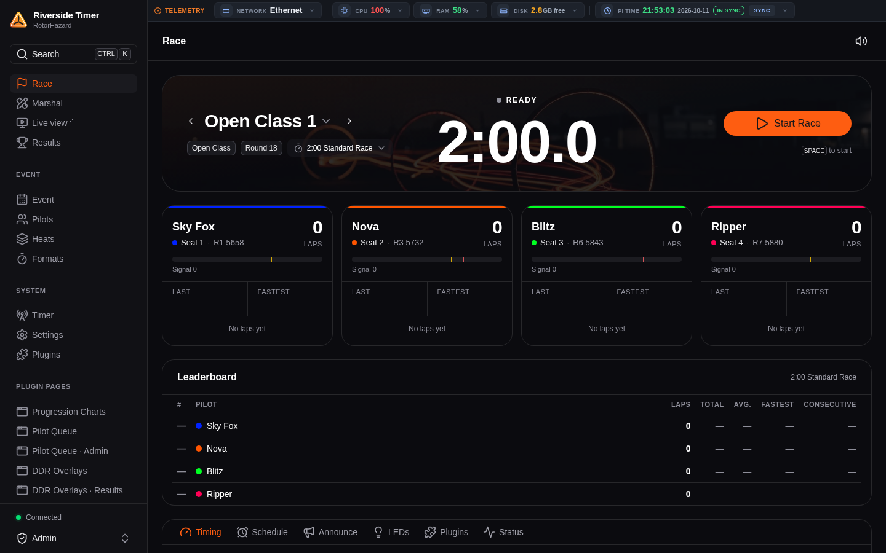
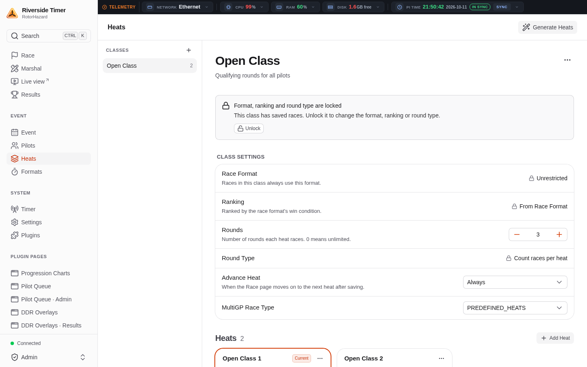
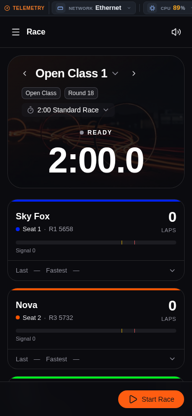
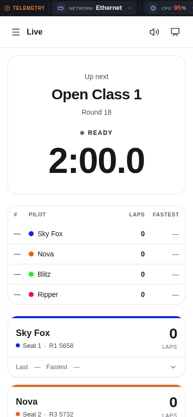

# RotorHazard Web App

[](https://github.com/bob9/rotorhazard-webapp/actions/workflows/rhfest.yaml)
[](https://github.com/bob9/rotorhazard-webapp/actions/workflows/tests.yaml)

A modern, mobile-friendly web interface for the [RotorHazard](https://github.com/RotorHazard/RotorHazard)
FPV race timer, packaged as an ordinary RotorHazard plugin (`rh_webapp`). It is a
single-page app built with [Nuxt UI](https://ui.nuxt.com) that runs on a **stock,
unmodified RotorHazard 4.3.0 or later** (RHAPI 1.3+): no core files are changed, and
the classic interface stays exactly as it is, one tap away.

- Opens at the timer's address (`/` → `/app/`); the classic pages keep their URLs
  (`/run`, `/marshal`, `/format`, `/settings`, ...).
- Uses the same Socket.IO events as the classic pages, so every timer feature and
  every plugin works: plugin panels appear on the matching app page, plugin pages
  (`blueprint_add`) open inside the app, plugin status bars run on every page.
- Light and dark themes, laid out for phones, tablets and desktops.
- Translated into all nine languages RotorHazard ships.
- Works offline (everything is bundled, no CDN); no Node.js needed on the timer.

| Desktop, dark | Desktop, light |
|---|---|
|  |  |

| Phone, dark | Phone, light |
|---|---|
|  |  |

<sub>Screenshots taken on a timer with a few community plugins installed (the telemetry bar and the "Plugin Pages" come from those plugins).</sub>

## Compatibility

| RotorHazard | RHAPI | Status | Not available in the app on this release |
|---|---|---|---|
| 4.3.0, 4.3.1 | 1.3 | Supported (tested on 4.3.1) | Editing the current race's laps before saving it (edit them on Marshal after saving); "Ignore Crossings Before"; choosing a pilot's seat in a heat plan; Marshal Auto Adjust |
| 4.4.0 | 1.4 | Supported (tested) | Marshal Auto Adjust |
| 4.5.0 beta | 1.5 | Supported (tested on 4.5.0-beta.2) | Marshal Auto Adjust |
| `main` (4.5.1-dev) | 1.9 | Supported (tested) | Everything available |
| 4.2 and earlier | ≤ 1.2 | Not supported | |

Each feature is detected from the server it runs on (the Socket.IO actions it handles,
listed in `/app-info` as `features`), so the app hides what a release lacks instead of
offering a button that does nothing. Tested on each release: the plugin's test suite,
installing `rh_webapp.zip` through RotorHazard's own *Install from file*, and a browser
run of a race (start, laps, stop, save), Marshal (re-saving a race), Heats, Settings,
Plugins, Docs and switching to the classic interface and back.

Note for 4.3.x installed today: its pinned Flask-SocketIO 5.4 does not work with Flask
3.1.3 or later (a RotorHazard dependency issue, not this plugin's); keep Flask at 3.1.0
to 3.1.2 there.

## Install

Any of these; then **restart the server**.

1. **Plugin manager, from a file**: download `rh_webapp.zip` from the
   [latest release](https://github.com/bob9/rotorhazard-webapp/releases/latest), then in
   RotorHazard open *Plugins › Install from file* and choose the zip.
2. **Community plugin list**: once listed, install *RotorHazard Web App* from the
   Plugins page like any other plugin.
3. **Copy the folder**: copy `custom_plugins/rh_webapp` into the timer's data
   directory as `plugins/rh_webapp` (usually `~/rh-data/plugins/rh_webapp`):
   ```bash
   git clone https://github.com/bob9/rotorhazard-webapp.git
   cp -r rotorhazard-webapp/custom_plugins/rh_webapp ~/rh-data/plugins/
   ```
   The built app is committed inside the folder (`rh_webapp/webapp`), so a plain
   checkout works without Node.js.

To remove it, delete the plugin in *Plugins* (or remove the folder) and restart: the
timer is back to stock, with nothing else to undo.

## Using it

| | |
|---|---|
| `/` | Opens the web app (or its welcome screen on a new timer), unless set otherwise below |
| `/app/` | The web app |
| `/classic` | The classic home page (and remembers "classic" for this device) |
| `/interface/app?to=…`, `/interface/classic?to=…` | Switch this device to the other interface, opening the matching page |
| Classic menu (⋮) › **New interface** | Added to every classic page by the plugin |
| App: account menu or search (Ctrl+K) › **Classic interface** | Back to the classic page that matches the app page |

Each device remembers its own choice (cookie `rh_interface`). Devices that have not
chosen get the timer's default.

### Settings

- **Default interface**: *Settings › General › Default Interface* in the app, or
  *Settings › Web App › "Open the classic interface at this address"* on the classic
  Settings page. Stored in `config.json` as `UI.classicInterface` (the same item the
  core-integrated branch uses). Default: the new interface.

### For plugin authors

Plugin pages added with `rhapi.ui.blueprint_add()` are found automatically (parameterless
GET routes that render HTML) and listed for admins under *Plugin Pages*. To name a page,
or to list it for everyone:

```python
try:
    from plugins.rh_webapp import register_nav_link
    register_nav_link('my_page', 'My Page', '/my-page', admin_only=False, order=0)
except ImportError:
    pass
```

## Public API only

The plugin uses only RotorHazard's public plugin API (RHAPI) and Flask; it does not
reach into RotorHazard's internals (RHFest rule RH001). All decisions about facts RHAPI
does not offer live in [`compat.py`](custom_plugins/rh_webapp/compat.py):

| Fact | Source in the plugin |
|---|---|
| Admin sign-in | `rhapi.config` `SECRETS.ADMIN_USERNAME`/`ADMIN_PASSWORD`, compared in constant time; open only while both are empty, as RotorHazard's own check |
| First-run (new timer) | Whether `rhapi.server.data_dir` had a config file when the plugin started (RotorHazard starts in first-run mode without one); it ends when the app's welcome screen finishes or the classic `/first-run` page is opened. Used only to choose what `/` opens and to offer the welcome screen, **never** for access: before setup the timer's (default) credentials are required, where RotorHazard itself is open |
| Release and node versions | `rhapi.server.info` |
| Number of nodes | `rhapi.interface.seats` |
| LEDs, VRx | `rhapi.led.enabled`, `rhapi.vrxcontrol.enabled` |
| Secondary timers (cluster) | `rhapi.config` `GENERAL.SECONDARIES` |
| Site-wide plugin scripts | Plugin panel Markdown seen through the public `emitUI` filter, and found by the app itself from the panels it loads |
| Docs | `rhapi.server.program_dir` |
| Features of the running release | The Socket.IO handlers registered with Flask-SocketIO, else the RHAPI version (`rhapi.API_VERSION_MAJOR/MINOR`) |

## Differences from the core-integrated branch

The [`webapp-redesign`](https://github.com/bob9/RotorHazard/tree/webapp-redesign) branch
builds the same app into RotorHazard itself. As a plugin on a stock server:

| Feature | In the plugin |
|---|---|
| App at `/app/`, `/` opens it, interface switching, "New interface" on classic pages | Reimplemented in the plugin's blueprint (redirect targets limited to known pages) |
| `/app-info`, `/app-auth`, `/app-docs`, `/app-database`, `/app-node-firmware`, `/app-first-run-done` | Reimplemented with RHAPI, same names and answers |
| Plugin pages in the sidebar | Discovered from the Flask URL map; `register_nav_link` from this plugin |
| Live updates of event name and settings on other devices | From RotorHazard's `OPTION_SET`/`CONFIG_SET` events (never SECRETS) |
| Translations of the app's own strings | Shipped in `translations.json`, served at `/app-strings` |
| Classic pages accept the app's admin sign-in | **Not available**: needs a change to RotorHazard's authentication. Switching to classic pages as an admin shows the browser's login prompt once per session |
| Restart-required banner on load | **Degraded**: RHAPI has no way to read the flag; the banner appears when the server announces it (`restart_required` event) while the app is open |
| Update Nodes tool | **Hidden** in the app: whether the nodes can be flashed is not in RHAPI. Use the classic `/updatenodes` page |
| About text (server details) | **Left out**: not in RHAPI. Release and node versions are still shown |
| IMDTabler availability | Not known up front; the IMDTabler page asks the server |
| LED settings for LED events on a secondary timer | Approximated from `GENERAL.SECONDARIES` entries that receive events |
| First-run setup | The app's welcome screen works as before. Until it is finished, the plugin's admin endpoints need the timer's default credentials (RotorHazard's own pages are open then). After the app's welcome screen, RotorHazard itself still counts as in first-run mode until its next start, so a device that chose the classic interface is sent to the classic first-run page once more until then |

## Known limitations

- Admins switching to the classic pages get the browser's own login prompt (see above).
- Classic pages that don't use the classic layout (stream overlays, some plugin pages)
  don't get the "New interface" link.
- Upstream behaviour to be aware of: on stock RotorHazard, `load_data` with
  `{type: 'config'}` returns any config item asked for, including stored credentials,
  to any client. The app asks only for `SECRETS.ADMIN_USERNAME`; the database viewer
  leaves out options whose name looks like a credential.
- Requires RotorHazard 4.3.0 or later; features newer than the running release are
  hidden (see Compatibility).

## Development

Layout:

```
custom_plugins/rh_webapp/   the plugin (folder name = domain)
  manifest.json
  __init__.py               initialize(rhapi): blueprint, routes, settings, live updates
  pages.py                  plugin page discovery, site scripts, interface switch targets
  compat.py                 the facts the app needs, from public RHAPI only
  translations.json         the app's own strings in RotorHazard's 9 languages
  static/classic.js         "New interface" link on classic pages
  webapp/                   the built app (generated by `npm run build`; committed)
ui/                         the app's source (Nuxt 4 + Nuxt UI 4), see ui/README.md
tests/                      pytest, against a stock RotorHazard server
scripts/package.sh          build + zip for release: dist/rh_webapp.zip
```

Build the app (Node.js 22):

```bash
cd ui
npm ci
npm run dev            # http://localhost:3000/app/ (proxies to a timer on :5000 that has the plugin installed)
npm run build          # builds into custom_plugins/rh_webapp/webapp
```

Commit `custom_plugins/rh_webapp/webapp` together with app source changes.

Package (builds, then zips; `SKIP_BUILD=1` zips the committed build):

```bash
scripts/package.sh     # dist/rh_webapp.zip
```

Tests boot a stock RotorHazard server with the plugin installed. Point `RH_SERVER_DIR`
at a RotorHazard checkout (the folder holding `src/server`; any supported release) whose
Python dependencies are installed (`pip install -r src/server/reqsNonPi.txt pytest`);
without it, upstream `main` is cloned once into `tests/.rotorhazard` (`RH_SERVER_REF`
picks another branch or tag). For releases that predate `RH_DATA_DIR`, the tests point
the server at their own data directory with a temporary `datapath.ini` next to
`server.py`, removed again as soon as the server has loaded. CI runs them against
4.3.1, 4.4.0, 4.5.0-beta.2 and `main`:

```bash
RH_SERVER_DIR=~/RotorHazard python -m pytest tests
```

Releases: bump `version` in `custom_plugins/rh_webapp/manifest.json`, then publish a
GitHub release tagged `v<version>`; the Release workflow builds the app and attaches
`rh_webapp.zip`.

## Credits

- [RotorHazard](https://github.com/RotorHazard/RotorHazard) by Michael Niggel and
  contributors: the timer, its interface wording and translations this app builds on.
- [Nuxt](https://nuxt.com), [Nuxt UI](https://ui.nuxt.com) and [Lucide](https://lucide.dev) icons.
- Plugin and app by bob9 (Three Digital Llamas).

## License

Distributed under the same license as RotorHazard (MIT NON-AI License, with
RotorHazard's branding terms); see [LICENSE](LICENSE). The RotorHazard name and logo
belong to their owners as described there.
